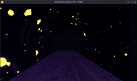

# Túnel de la Ciencia, Metro CDMX

## Descripción General

El proyecto busca crear una representación en 3D del transbordo de la estación
**La Raza** del metro de la CDMX; el ambiente cuenta con dos tipos de cilindros;
uno dedicado a la representación de la entrada y salida del Túnel de la Ciencia
y el segundo es este túnel.

El usuario tiene la experiencia de ver el cielo
estrellado con una luz ambiental violeta y destellos neón para recrear el
ambiente. El modelo cuenta con limitaciones de movimiento en los
distintos ejes, en los ejes **X, Y** el movimiento se limita para que no pueda salir
del diámetro del cilindro, mientras que la limitación del eje **Z** está
diseñada para que el usuario no pueda salir de los cilindros y explorar el resto
del modelo.


## Exploración del modelo

La interacción entre el usuario y el mundo es mediante el teclado y el mouse.

Tecla|Respuesta en el mundo|
:---|:---|
W|Movimiento hacia adelante
S|Movimiento hacia atrás
D|Movimiento a la derecha
A|Movimiento a la izquierda
`ESC`|Cierra el programa
`SPACE`|Permite el salto vertical del personaje

El mouse se utiliza para el movimiento de la cámara.

## Técnicas de graficación aplicadas

Durante el desarrollo del proyecto se aplicaron diversas técnicas entre ellas:

**Modelado 3D**

Utilicé **Blender** para modelar en 3D el cilindro y el plano que funciona
como suelo y exporté el resultado en el archivo `cilindro.obj`.

**Transformaciones geométricas**

Para la traslación por copia de cada cilindro utilicé transformaciones
así como escalaciones en el eje **Z** para espejear y que las uniones fueran 
continuas.

**Iluminación**

Generé una lámpara por copia, difuso con atenuación, especular, ambiente y 
parpadeo con fase por copia.

**Texturizado**

Generé el archivo `atlas.png` con la herramienta **GIMP** donde le asigné la
parte inferior a la textura del concreto para el suelo, y la parte superior
la dividí en dos regiones, la región izquierda fue dedicada al cielo del túnel
mientras que la región derecha tiene como objetivo replicar la estética de
los pasillos del metro en la CDMX.

**Cámara y proyección**

Diseñé la cámara en primera persona

**Renderizado en tiempo real**

El modelo se renderiza en tiempo real

## Tecnologías y dependencias

Entre las tecnologías que se utilizaron se encuentran:

**Python**

Fue para manejar la lógica de colisiones, lectura del archivo
`cilindro.obj` y extracción de la geometría de los objetos, lógica de la cámara.

**glfw**

Lo utilicé para la creación de la ventana y contexto del programa, también
me sirvió para el manejo de eventos del sistema así como las entradas del
teclado.

**moderngl**

Es el core del proyecto, utilicé **OpenGL 3.3 core** para la comunicación
con la tarjeta gráfica, lo que permitió el renderizado del proyecto

**PyGLM**

Fue de gran utilidad para las transformaciones de los objetos y para las
operaciones entre matrices.

**Pillow**

Con la ayuda de esta biblioteca se lee el archivo `atlas.png`

**Numpy**
    
Me apoyé en esta librería para el manejo de valor absoluto y generación de arreglos.

**GLSL**

Se encarga de la iluminación en los shaders.

## Estructura del proyecto

```
Túnel de la Ciencia, Metro CDMX/
├── main.py # ventana, contexto, bucle de render
├── modelo.py # lectura del OBJ y medidas del cilindro
├── camara.py # movimiento, gravedad, colisiones
├── config.py # constantes y rutas
└── shaders/
│   ├── vertex.glsl
│   ├── fragment.glsl
└── recursos/
│   ├── cilindro.obj
│   ├── atlas.png
│   ├── demo.gif
├── README.md
├── requirements.txt
├── demo.gif
└── .gitignore
```

El proyecto se probó en GNU/Linux, por lo tanto, las siguientes secciones se
enfocan en las instrucciones de este sistema.

## Instalación
```bash
# Clonar el repositorio 
git clone https://github.com/Maxxxm69/Tunel-de-la-Ciencia
# Acceder al directorio
cd túnel-de-la-Ciencia/
# Crear entorno virtual y activar 
python -m venv venv
source venv/bin/activate
# Instalar dependencias y requerimientos
pip install -r requirements.txt
```

## Ejecución
```bash
source venv/bin/activate
python3 main.py
```

Dentro del programa puedes explorar el mundo con los controles que se indicaron
en las secciones anteriores.



## Integrantes

**Nombre**: Gutierrez Miguel Maximiliano de Jesus

**Asignatura**: Computer Graphics

**Profesora**: Rosaura Palma Orozco

**Semestre**: Agosto-Diciembre 2026